# Frameo Home Assistant dashboard

A fast Home Assistant wall dashboard for a Denver Frameo photo frame (`PFF_1037`: RK3126, Android 6.0.1,
WebView 107). The page is bundled inside a small kiosk APK and loads from `file:///android_asset/index.html`.
It reads Home Assistant over one websocket (Nabu Casa or any `wss://` URL) with a long-lived access token.
It should adapt to other cheap Android frames and tablets; only the sleep and navigation tweaks are device specific.
To set up a tablet, point a coding agent at [TABLET.md](TABLET.md).

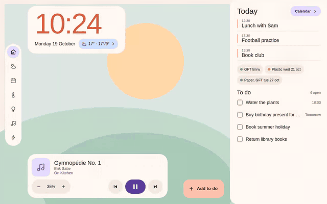

Demo data, not a real home ([full-size video](docs/demo.mp4)).

Measured on the frame: the page appears in 1.9 s; idle for 30 s it draws 1 frame, 0 janky.
The HA frontend's own login page on the same hardware: 80 % janky frames.

## Screens

Soft pastel cards on a landscape background: day (sage hills, sun) and night (moon, stars, dark hills),
switched at sunset and sunrise from `sun.sun` (19:00 to 07:00 on the frame's clock when HA has no sun entity).
Flat colours, no shadows, ripples or animations, because the frame is a 1 GHz Cortex-A7. Fixed 1280x800.

| Day | Night |
| --- | --- |
| 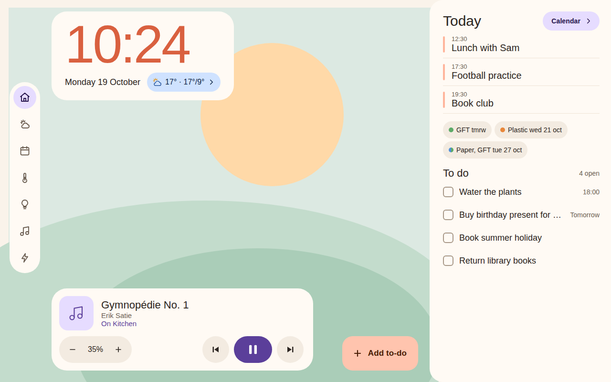 | 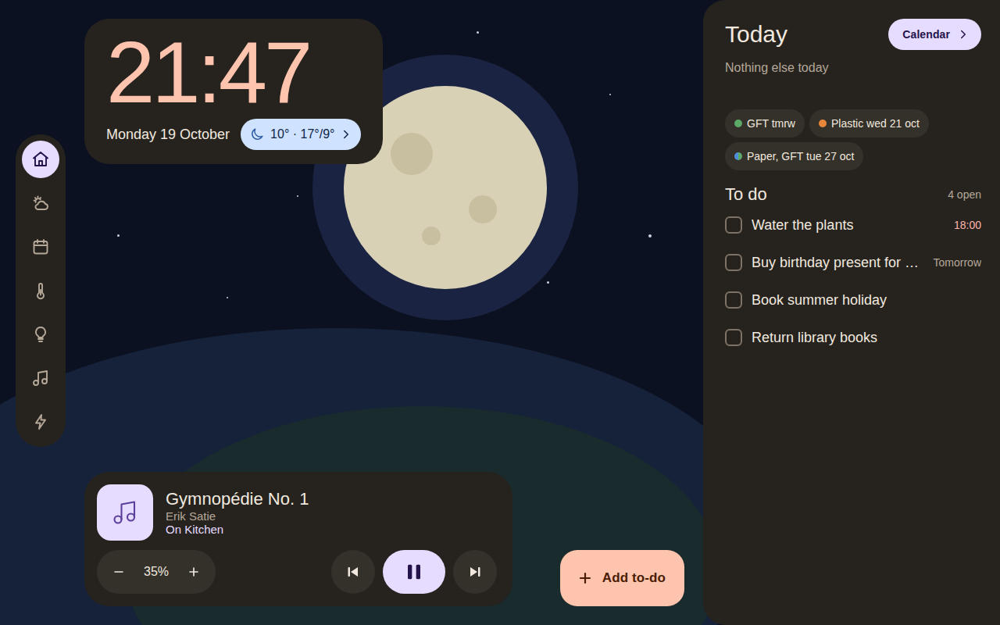 |
| 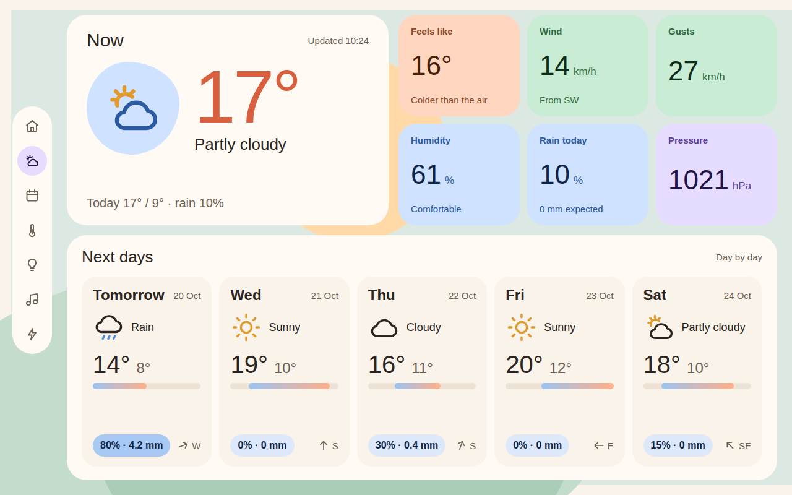 | 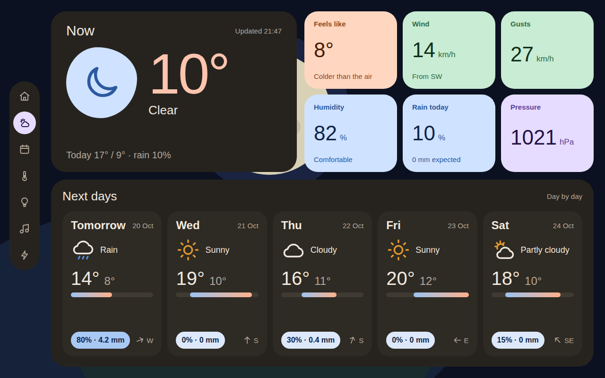 |
| 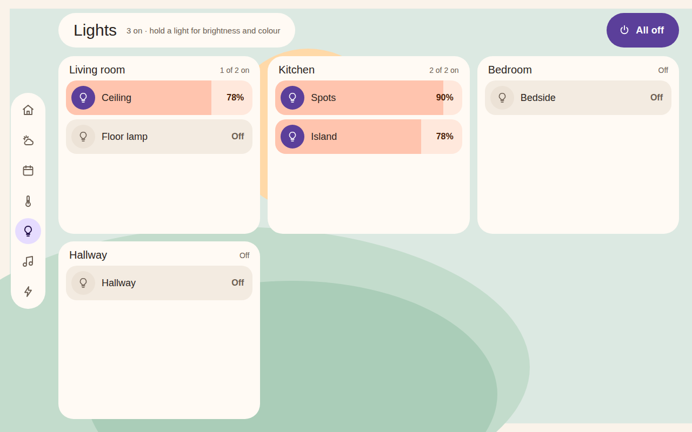 | 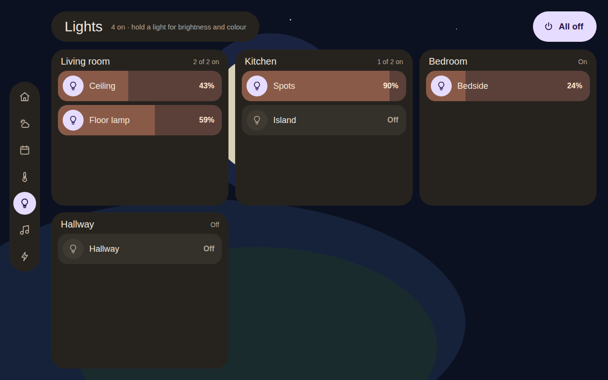 |
| 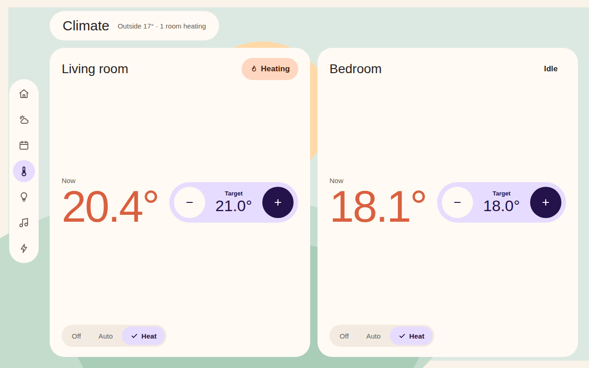 | 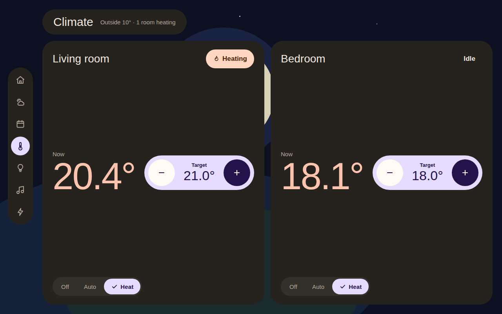 |
| 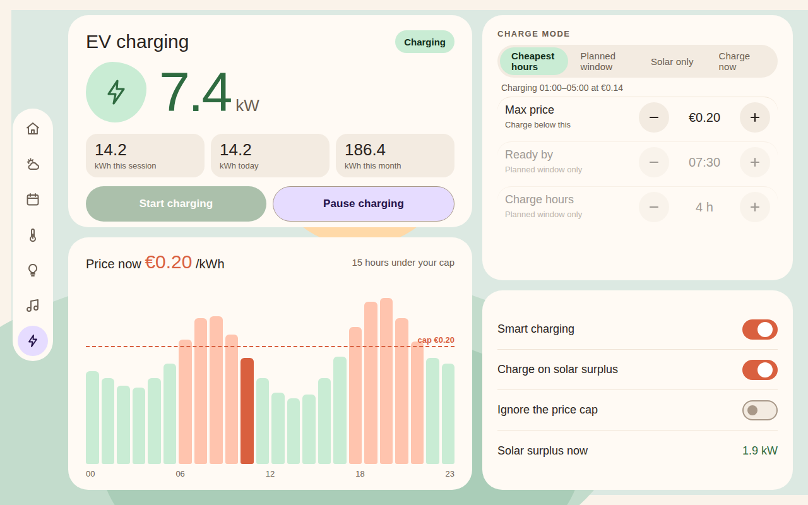 | 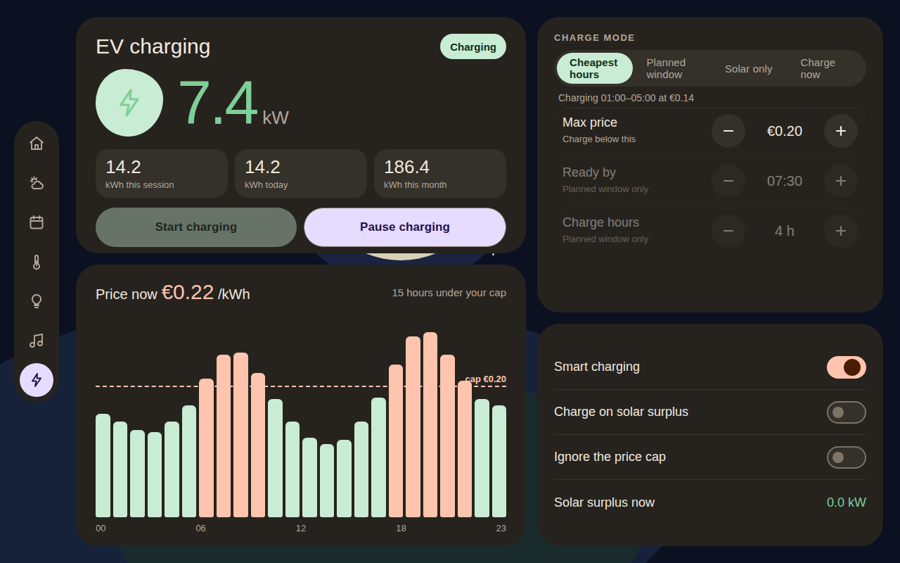 |
| 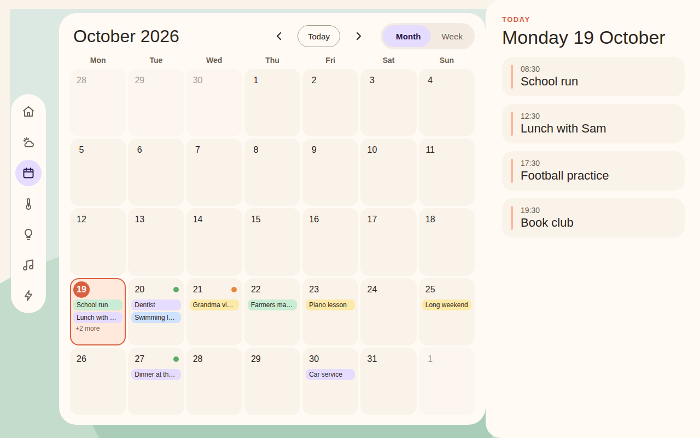 | 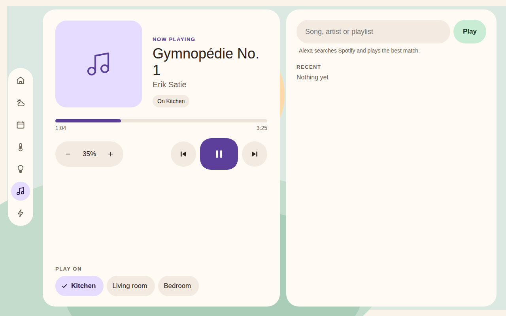 |

| Tab | What it shows |
| --- | --- |
| Home | Clock and a weather chip, then a Today panel: what is left of today's agenda, the next bin collections, the to-do list, and a music card (follows the speaker that is playing; tap it for the Music tab) |
| Forecast | Now, six detail tiles (feels like, wind, gusts, humidity, rain, pressure), and the days after today |
| Calendar | Month grid with a day sheet, or week columns |
| Climate | Thermostat zones: current temperature, -/+ target, Off/Auto/Heat |
| Lights | One card per room, one row per light: tap to toggle, hold for brightness, colour temperature and colour swatches, All off |
| Music | Now playing on an Alexa/media_player speaker, volume, previous/next, "play on" speaker, search that plays on Spotify |
| Recipes | Search the Garfinho recipe library by name or ingredient, filter chips, favourites with a heart, and a recipe page with photo, tags and tickable ingredients |
| Solar | Production, house, battery (charge %, charging or discharging) and grid (bought and sold today) from the inverter's sensors |
| EV | Charger state and power, session/day/month kWh, price bars with your cap, charge mode, switches |
| Caméras | Up to four RTSP cameras in a 2x2 grid, tap one for full screen |
| Photos | Full screen photos from the Frameo app's folder (sent with the Frameo phone app), shuffled, one a minute; two portraits share the screen; tap left/right for previous/next, the middle for Home |
| Settings (gear) | Dashboard version, update address, Update now, Use built-in |

Photos tab: the kiosk app reads `/sdcard/frameo_files/media`, where the Frameo app saves received photos. It asks
for storage access once on the frame (or `adb shell pm grant com.wesbos.homehq android.permission.READ_EXTERNAL_STORAGE`).
Optional `photos` (URLs or `/local/...` paths, added to the Frameo ones) and `photoSeconds` (default 60).

Optional `background`: `"frameo"` for a random landscape from the Frameo app's photos, a photo instead of the drawn
landscape, or a list of photos; it changes every 10 minutes.
Put the files in Home Assistant's `/config/www/` folder and list them as `/local/<name>.jpg` (or give full URLs).
Size them to 1280x800 JPEGs; the frame is slow to scale big photos. At night the photo is darkened.

Tabs whose entities are not in your config are hidden (Climate, Lights, EV, Music, Recipes), so you only get what you set up.

## Configure

Copy `secrets/config.example.json` to `secrets/config.json` (gitignored) and fill in:

- `host`, `token`: your HA address and a long-lived token. A bare host (`xxx.ui.nabu.casa`) means https/wss; for a
  LAN install give the scheme and port, e.g. `http://192.168.1.10:8123`. Prefer a non-admin user's token: it is
  readable by anyone with ADB on the frame.
- `cameras`: `[{ "name", "url" }]` RTSP cameras (`rtsp://user:pass@ip:554/…`) for the Caméras tab, up to four in a 2x2
  grid; a tap shows one full screen, another tap goes back. Optional `"full"`: another stream for full screen (the HD
  `stream1` while the grid uses `stream2`); when the frame cannot play it, the grid's stream plays instead. The kiosk app plays them with Android's own player (a page
  cannot play RTSP), so they only show on the frame. Use the cameras' H.264 sub-stream (e.g. Tapo `stream2`): four HD
  streams are too much for the frame.
- `gusts` (optional): a gust sensor, e.g. MeteoSwiss's `sensor.wind_gusts_peak_1s_at_…`, for the Rafales tile.
- `weather`, `waste`, `calendars`: entity ids. `waste` (optional) is a calendar of bin collections (shown as chips).
- `temperatures`: `[{ "id", "name", "humidity" }]` temperature sensors (humidity optional), shown as chips under the date
  on Home and as cards on the Climate tab after any thermostats. The card's pictogram follows the room's name (salon,
  chambre, cuisine, bureau, bain, enfant, garage, jardin…); `"icon"` forces one of `sofa`, `bed`, `kitchen`, `desk`,
  `bath`, `kid`, `garage`, `pool`, `outdoor`, `thermo`. Light rooms get the same pictograms.
- `todo`: a `todo.*` entity, or a list of them (ids, or `{ "id", "name" }` to rename one); several lists show as tabs on
  the Home card, and Add and ticks go to the tab on screen. `climate`: a list of climate entities (`[]` or left out hides the tab).
- `lights`: `{ "id", "name", "room" }` per light (a `switch.*` such as a smart plug works too); lights with the
  same `room` share a card.
- `solar`: inverter sensors for the Solar tab, each optional: `pv` and `pvToday` (production now / today), `forecastToday` (or `forecastRemaining`, added to
  today's production), `forecastTomorrow`, `forecastDay2` (kWh) and `peakToday` (a timestamp) from a solar forecast, `load`
  (house now), `battery` and `soc`, `chargeToday` and `dischargeToday` (battery kWh), `grid` (now), `importToday` and `exportToday`. A card shows when its sensors are set.
  `invertBattery` / `invertGrid` flip an inverter that reports charging or buying as negative.
- `ev`: ids for the charger, price sensor (a Nord Pool style sensor with a `today` list), cap, mode and switches.
- `recipes`: `{ "favorites": "sensor.garfinho_favorite_recipes" }` for the Garfinho integration (its `garfinho.search`,
  `add_favorite` and `remove_favorite` services). The feed has titles, photos, tags and ingredient names, but no
  quantities or method.
- `music`: `{ "speakers": [{ "id", "name" }] }` media players. Search sends `play_media` with `"<query> on Spotify"`,
  which Alexa Media Player understands; `"search": false` hides the search box for other speakers or without Spotify. Optional `library`: a SpotifyPlus media player, which adds Playlists, Recent,
  Liked songs, Artists and Albums from your Spotify account; a tile plays on the selected speaker through Spotify Connect
  (`device` on a speaker overrides the Spotify device name, which defaults to the speaker's name in HA).
  Setup and quirks: [docs/spotifyplus.md](docs/spotifyplus.md).
  Or `"assistant": "<config entry id>"` for Music Assistant: shelves of your MA radios, playlists, albums, artists
  and tracks, and a search box that searches MA; a tile plays on the selected speaker with `music_assistant.play_media`
  (the speakers must be MA players). To find the entry id: Developer tools, Actions, `music_assistant.get_library`, pick
  your Music Assistant instance, then Go to YAML mode: it shows `config_entry_id`.

## Build and deploy

Both builds sign with `secrets/debug.keystore` (created on first build, gitignored), so an APK from either machine
updates the other's install. Copy that file between checkouts once, or the frame refuses the update.

Linux (Android SDK in `~/Android/Sdk`: build-tools 36.1.0 and platform android-36.1):

```sh
./build-linux.sh && adb install -r build/homehq.apk
adb shell am start -n com.wesbos.homehq/.MainActivity
```

Windows with WSL (Windows Android SDK and Android Studio JBR): `./build.sh`, then install `build/homehq.apk`
with the Windows `adb.exe`.

Quick deploy, on the computer the frame is plugged into, when the APK was built elsewhere (a Codespace) and
downloaded: installs the newest `homehq*.apk` in Downloads (browsers save repeats as `homehq (1).apk`), starts it,
then removes the downloaded copies so the next download keeps its name.

```sh
apk=$(ls -t ~/Downloads/homehq*.apk | head -1) &&
adb install -r "$apk" &&
adb shell am start -n com.wesbos.homehq/.MainActivity &&
rm ~/Downloads/homehq*.apk
```

A URL saved with `--es url` overrides the bundled page. `pm clear com.wesbos.homehq` removes it.
The token is inside the APK. Rotate it if the APK leaves your hands.

## Updates over wifi

After the first APK install, page changes (new tabs, styling, config) do not need ADB or a rebuild:

1. Serve the files from any static host:
   - quick: `./serve.sh` on your computer (port 8099); add `--no-config` to keep your token off it;
   - permanent: an always-on Linux box with Caddy (setup in [docs/update-server.md](docs/update-server.md)),
     then `./publish.sh user@<ip>` from any machine.
2. Tell the frame where to fetch from, once:
   `adb shell am start -n com.wesbos.homehq/.MainActivity --es update_url http://<host>:8099`
3. On the frame: Settings (gear at the bottom of the rail), Update now. Or the two-finger menu, Update dashboard.

The app downloads every file in `manifest.json` to a temp folder and swaps it in only when all succeeded, so a failed
update leaves the running copy alone. `config.js` (the token) stays on the frame unless the manifest lists it
(`./publish.sh ... --with-config`). Java changes (sleep, menu, permissions) still need a new APK; ADB over wifi
(`adb tcpip 5555`) makes that wireless too. "Use built-in" returns to the page bundled in the APK.

Full setup, other hosts and troubleshooting: [docs/update-server.md](docs/update-server.md).

## Layout of the code

- `page/`: the dashboard, plain ES5 scripts that `index.html` loads in order into one scope (the frame's WebView 107
  has no modules). `common.js` holds the shared pure code: dates, icons, the Home Assistant protocol. Each tab has a
  file (`home.js`, `todo.js`, `forecast.js`, `calendar.js`, `climate.js`, `lights.js`, `music.js`, `ev.js`,
  `recipes.js`, `settings.js`) with its pure functions (tested) and a function that wires the tab's DOM and returns
  the hooks it wants: `onConnecting`, `onConnected`, `onView`, `onUpdate`, `onTick`, `closeSheet`. `app.js` holds
  `start()`, which builds the tabs and calls those hooks from the clock, the nav and the socket. It subscribes to `subscribe_entities` for the entities in your config, calls
  `calendar.get_events` (every 5 min) and `weather.get_forecasts` (every 30 min), and touches the DOM only when
  a value changes. Reconnects with backoff (max 60 s) and shows "No connection for N min" when stale.
  Back to Home after 3 idle minutes; reloads itself daily at 03:00.
- `kiosk/`: the Android WebView shell, based on `dashboard/kiosk` of wesbos/photo-frame-dashboard (6cbc255), with:
  the bundled page as the default URL; a menu on a two-finger hold (1.5 s, 120 px slop) or a one-finger 3 s hold on the
  empty bottom of the rail; touch logging (tag `HomeHQ`); screen sleep after 5 idle minutes through `su`
  (`--ei sleep_minutes N`, `0` = never; see [docs/frame.md](docs/frame.md#screen-sleep)) with a first tap that only wakes; and `PageUpdater` for over-the-air updates.
- `tools/`: `render-config.mjs` (config to `config.js`), `manifest.mjs` (the update manifest).
- `test/`: unit tests with recorded HA responses. `npm test` (uses `TZ=Europe/Amsterdam`).
- `homeassistant/todo-reminders.yaml`: push notification when a to-do comes due (edit the list and notify targets).

## To-do and reminders

`todo` is a Home Assistant to-do entity (a Local To-do list works; Google Tasks only keeps dates, not times).
Tap an item to complete it, tap Add to type one and pick a reminder (none, in 1 hour, this evening, tomorrow 09:00),
saved as the item's due time. The push is sent by HA: install `homeassistant/todo-reminders.yaml` as an automation.
Adding an item needs an on-screen keyboard on the frame; without one, add items from the phone.

## Quirks

- [docs/frame.md](docs/frame.md): the frame's hardware limits and what the kiosk app does about them (start at boot as
  the Home app, sleep, menu, offline screen, debugging, navigation bar, updates).
- [docs/home-assistant.md](docs/home-assistant.md): websocket protocol, dates and offsets, and the integrations.
- [docs/spotifyplus.md](docs/spotifyplus.md): Spotify search and library on the Music tab.
- [docs/update-server.md](docs/update-server.md): the update file server (serve.sh, an always-on Linux box, or your own host).

## Licence

MIT, see [LICENSE](LICENSE). `kiosk/` derives from [wesbos/photo-frame-dashboard](https://github.com/wesbos/photo-frame-dashboard),
also MIT; its copyright notice is kept in LICENSE.
